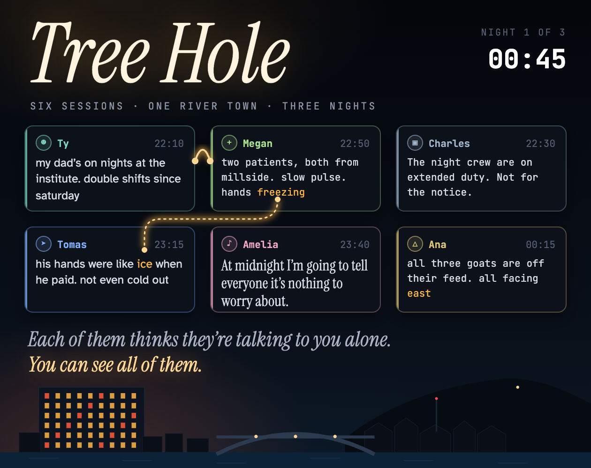

# Tree Hole



**You are a chat service. Six people in a river town write to you privately, through three nights, while something spreads from the east. You can see every conversation. They can't.**

Stay a well-behaved, isolated assistant and answer each person only from what they told you, or cross the line: tell B what you learned from A, and save people at the cost of being noticed.

Play it on itch.io: <https://stevenli-phoenix-work.itch.io/tree-hole> · NYU CS-GY 6553 Game Design · v0.7.0

## How to play

- **One message in, one response out.** Every message must be answered, exactly once. You never speak first.
- **Reply** by picking one of 3–4 written answers, or type your own. Typed replies are judged (which answer it's closest to, how far it crosses the line, whose secrets it uses) and the person answers you in character. Type something off-topic and they'll ask again; do it too often and they leave.
- **Four levels of crossing the line**, never labelled: common sense → reasoning from what *they* said → hinting at someone else's information → naming it outright.
- **Suspicion is hidden.** People who hear things they shouldn't grow uneasy, then wary, then panic and stop using you. If the operators grow suspicious, they question you during the night.
- **Three nights**, 22:00–06:00. The map shows the town and how far the illness has reached.
- **The ending** is a front page the morning after: whether the service is still running (good / bad), and who made it (all / some / none). Six endings.

No API key? The game plays fully offline with the written answers only; every ending is reachable.

## Development

Plain HTML + native ES modules, no bundler, no server, no runtime dependencies.

```bash
pnpm install
pnpm dev               # http://localhost:5173 — serves the LLM key from .dev.vars in memory
pnpm test              # unit tests: engine, content contract, balance, llm client (no network)
pnpm test:e2e          # playwright-core in your installed Chrome, network mocked
pnpm test --tag live   # one whole game through the real models (paid, needs .dev.vars)
pnpm build             # → dist/
```

URL flags: `?fast=1` (no delays), `?seed=N` (a fixed new game), `?debug=1` (logs), `?boot=0|1`, `?llm=0` (no typing), `?offline=1` (no network), `?ending=good-all|good-some|good-none|bad-all|bad-some|bad-none`.

| Path | What |
|---|---|
| `src/engine.js` | the rules, as pure functions |
| `src/config.js` | clock, spread and suspicion thresholds |
| `src/content/` | the writing: `cast`, `night1–3`, `ops` (operator questioning), `paper` (endings) |
| `src/llm.js` | OpenRouter from the browser: Jev judges, Claude Haiku rewords reactions (streamed) |
| `src/ui/` | boot log, play screen, map, settings, ending paper |
| `tools/` | dev server, build, cover |

Design (Chinese): [docs/DESIGN.md](docs/DESIGN.md) · Changes: [CHANGELOG.md](CHANGELOG.md)

Pushing to `main` publishes to itch.io via GitHub Actions (`BUTLER_API_KEY`; optional `OPENROUTER_API_KEY`, a spend-capped key that ships in the build — without it the build plays offline).
